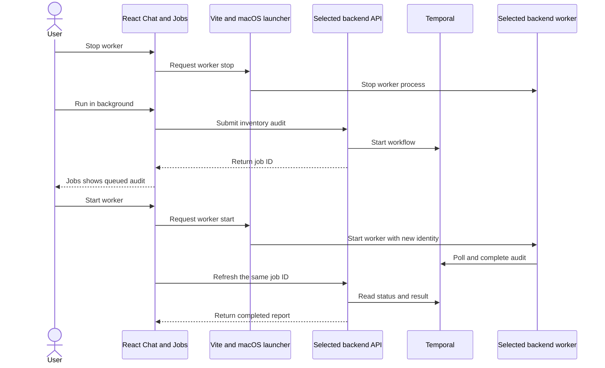

# Follow a chat turn through the code

## From React to the API

Start in [main.tsx](../apps/web/src/main.tsx). The `App` component keeps the prompt, selected backend and engine, and chat transcript in React state. On submit, `send` builds an array with the previous messages and the new user message, then sends it to `POST /api/chat` on the selected backend. The [browser routing helper](../apps/web/src/backend.ts) and [Vite proxies](../apps/web/vite.config.mjs) keep all three APIs on the same browser origin. It keeps run details, such as token counts, separate from the messages sent back on the next turn.

The [Go HTTP handler](../apps/api/internal/httpapi/server.go) decodes the request, validates the conversation, and calls `Agent.Reply`. The [OpenAPI YAML](../apps/api/internal/httpapi/contract/openapi.yaml) defines the public routes and JSON types. Run `make generate-api` after editing the contract. The [transport adapter](../apps/api/internal/httpapi/transport.go) converts between those generated types and the types used inside the agent.

The [TypeScript HTTP handler](../apps/api-ts/src/server.ts) serves the same YAML and validates request bodies with Zod. The [Python HTTP handler](../apps/api-py/workflow_lab/server.py) also serves the shared YAML and uses FastAPI with Pydantic validation. The **API reference** panel follows the backend picker, so the same documented request can be sent to any implementation.

## How the model uses a tool

In [agent.go](../apps/api/internal/agent/agent.go), the agent discovers tools and their input schemas through MCP. It passes those schemas and a conversation transcript to Ollama. A model response can contain a final answer or one or more proposed tool calls. The agent checks that each tool was advertised, sends its arguments to MCP, and appends the result to the transcript. The model then gets another request and can use the result in its answer or ask for another tool.

The [MCP server](../apps/api/internal/mcptools/server.go) is a child process with two read-only tools backed by demo data. The Go SDK uses the tool arguments' struct tags to help describe their input schemas. The tool responses contain inventory facts, which the model uses to write the answer.

The TypeScript [agent](../apps/api-ts/src/agent.ts) follows the same protocol. The API and worker each start their own [TypeScript MCP subprocess](../apps/api-ts/src/mcp.ts). The MCP SDK discovers the schemas from the registered tools, and Zod checks tool arguments. The worker and API use the same demo inventory fixtures as the Go implementation.

The [Python agent](../apps/api-py/workflow_lab/agent.py) uses the Python MCP SDK to connect to its own [inventory subprocess](../apps/api-py/workflow_lab/mcp_server.py). Its model calls and individual tool calls are async, so waiting on Ollama or the subprocess does not block the HTTP server.

## Where progress lives

| Engine | Go | TypeScript | Python | What happens on interruption |
| --- | --- | --- | --- | --- |
| Direct loop | [agent.go](../apps/api/internal/agent/agent.go) | [agent.ts](../apps/api-ts/src/agent.ts) | [agent.py](../apps/api-py/workflow_lab/agent.py) | The working transcript lives in memory for the current request. Restarting the API loses that in-progress turn. |
| State machine | [state_machine.go](../apps/api/internal/agent/state_machine.go) | [graph.ts](../apps/api-ts/src/graph.ts) | [graph.py](../apps/api-py/workflow_lab/graph.py) | The PostgreSQL checkpoint holds the transcript, completed tool results, and the next graph node. Resubmitting the same run ID and messages reloads that checkpoint. |
| Temporal | [temporal.go](../apps/api/internal/agent/temporal.go) | [workflows.ts](../apps/api-ts/src/workflows.ts) and [worker.ts](../apps/api-ts/src/worker.ts) | [workflows.py](../apps/api-py/workflow_lab/workflows.py) and [worker.py](../apps/api-py/workflow_lab/worker.py) | A worker executes Ollama and MCP calls as activities. Temporal records completed activity results, which a replacement worker uses during replay. An activity interrupted before completion was recorded can run again. |

All three graph engines save after each successful model or tool step. Go's reply lists one **Run tools** transition per batch. TypeScript and Python list the node execution for each tool call.

## How a background job finishes

In the chat, **Run in background** posts a standalone prompt to `POST /api/jobs`. The API returns HTTP 202 when Temporal accepts the workflow. The worker still needs to pick it up and finish it. The [Go job service](../apps/api/internal/agent/jobs.go), [TypeScript Temporal client](../apps/api-ts/src/temporal.ts), and [Python Temporal client](../apps/api-py/workflow_lab/temporal_jobs.py) list audits and retrieve completed reports from Temporal. Each worker polls its own task queue.

[The Jobs view](../apps/web/src/jobs.tsx) periodically fetches job summaries. It uses browser storage to remember which finished jobs you’ve opened. Temporal holds the job status and report, so closing the browser doesn’t cancel the work.

## How the worker controls work

The [shared worker panel](../apps/web/src/worker-control.tsx) stays mounted when Temporal Chat opens Jobs. It asks the [local Vite plugin](../apps/web/worker-control.mjs) for status. The plugin checks the selected task queue and matches the launcher's current worker identity against Temporal's reported pollers. Temporal can retain old poller records after a worker exits.

Start and stop requests update the launcher's requested state. [Start Lab.command](../Start%20Lab.command) starts or stops the corresponding worker process group. The APIs and Temporal server continue running. A manually launched Vite session can inspect task queues and leaves worker management to the terminal. The launcher control routes are local development endpoints outside the shared OpenAPI contract.

## Tracing a turn

The browser sends a correlation ID through [the TypeScript request helper](../apps/web/src/telemetry.ts). The [Go telemetry package](../apps/api/internal/telemetry/log.go) places it in the request context. MCP carries it in request metadata and Temporal carries it in workflow and activity headers. The TypeScript API passes the ID through Ollama headers, MCP request metadata, and Temporal activity inputs. Its [JSON logger](../apps/api-ts/src/logging.ts) records the backend and service for each event. The [Python logger](../apps/api-py/workflow_lab/telemetry.py) uses the same JSON fields. Python passes the ID in HTTP headers, MCP metadata, and the durable workflow input. Use **View logs** under a chat reply or job report to see the events for that ID.

## How model selection and installation work

The [model library](../apps/web/src/model-library.tsx) searches public Ollama tags and reads download progress one JSON line at a time. The [Go library client](../apps/api/internal/ollama/library.go) checks that a tag has a downloadable model layer. The [install handler](../apps/api/internal/httpapi/model_install.go) streams progress from the local Ollama process. The [TypeScript library module](../apps/api-ts/src/library.ts) verifies tags and streams the same Ollama progress format. After installation, the browser refreshes the installed-model catalog.

The selected tag is part of a chat or job request. A new graph checkpoint or Temporal workflow records the resolved model, including the configured default. Durable retries must match the original model and messages.

## Where the Database tab gets its results

Go’s [saved queries](../apps/api/internal/checkpoint/inspect.go) are defined alongside the PostgreSQL checkpoint adapter. The browser sends a query ID and, where needed, a run ID. The adapter supplies the run ID as a PostgreSQL parameter and executes the saved query in a read-only transaction. Each query returns columns and rows for the results table in [database.tsx](../apps/web/src/database.tsx).

The [TypeScript graph module](../apps/api-ts/src/graph.ts) manages its saved queries in a separate PostgreSQL schema. It uses the LangGraph saver to decode checkpoint state for the latest state, tool results, and token usage views. The same Database component renders the results for each backend.

The [Python graph module](../apps/api-py/workflow_lab/graph.py) uses the async PostgreSQL saver and its own schema. The [Python library handler](../apps/api-py/workflow_lab/library.py) verifies registry manifests and streams Ollama download progress to the same model panel.
